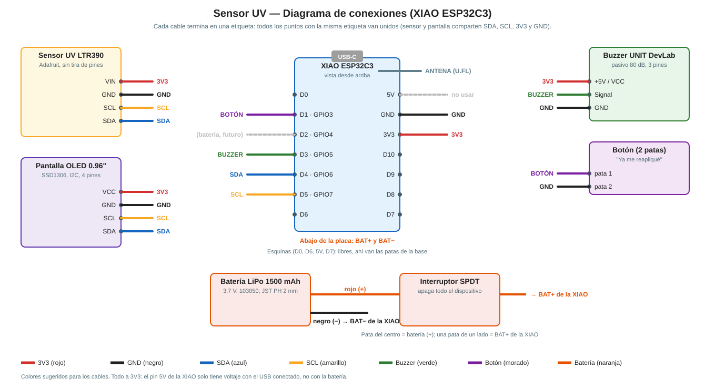

# Diagrama de conexiones — Sensor UV

Creado: 2026-10-13

Los pines salen de `dispositivo/src/pines.h`: si se cambian ahí, cambiar también este documento.

---

## Reglas generales
- **Todo a 3V3.** El pin **5V** de la XIAO solo tiene voltaje cuando el USB está conectado; con la batería no, así que no se usa.
- El **sensor y la pantalla comparten** los mismos 4 cables (3V3, GND, SDA y SCL): en la protoboard, ponerlos en la misma fila; en el armado final, unir los cables (soldadura y termofit).
- **Cables soldados directo** a cada módulo, sin tira de pines (la carcasa queda más chica y no se aflojan).
- Colores sugeridos: **rojo** 3V3, **negro** GND, **azul** SDA, **amarillo** SCL, **verde** buzzer, **morado** botón, **naranja** batería.
- Conectar y desconectar cables **siempre sin corriente** (sin USB y con el interruptor apagado).

---

## XIAO ESP32C3 (placa final)

| Pieza | Pin de la pieza | Pin de la XIAO |
|---|---|---|
| Sensor UV LTR390 | VIN | **3V3** |
| | GND | **GND** |
| | SDA | **D4** (GPIO6) |
| | SCL | **D5** (GPIO7) |
| Pantalla OLED | VCC | **3V3** |
| | GND | **GND** |
| | SDA | **D4** (GPIO6) |
| | SCL | **D5** (GPIO7) |
| Buzzer UNIT DevLab | +5V / VCC | **3V3** (suena un poco más bajo que a 5 V) |
| | Signal | **D3** (GPIO5) |
| | GND | **GND** |
| Botón | pata 1 | **D1** (GPIO3) |
| | pata 2 | **GND** |
| Antena | conector U.FL | conector de la antena de la XIAO (presionar hasta que haga "clic") |
| Batería LiPo | rojo (+) | **pata del centro del interruptor** |
| | negro (−) | **BAT−** (abajo de la placa) |
| Interruptor | una pata de un lado | **BAT+** (abajo de la placa) |
| *(futuro)* Medir batería | divisor 2 × 220 kΩ | **D2** (GPIO4) |

**No usar** los pines de las esquinas (**D0, D6, 5V, D7**): ahí van las patas de la base impresa. Tampoco D8 y D9 (pines de arranque).

**Batería:** BAT+ y BAT− son dos puntos para soldar **en la parte de abajo** de la XIAO. Con la batería conectada, la XIAO la carga sola por el USB-C. Revisar la polaridad (rojo = +) **antes** de soldar: al revés puede dañar la placa.

---

## ESP32-C6 DevKit (prestada, para pruebas)

| Pieza | Pin de la pieza | Pin de la ESP32-C6 (número impreso en la placa) |
|---|---|---|
| Sensor UV y pantalla | VIN / VCC | **3V3** |
| | GND | **GND** |
| | SDA | **23** |
| | SCL | **22** |
| Buzzer | +5V / VCC | **3V3** |
| | Signal | **19** |
| | GND | **GND** |
| Botón | pata 1 | **2** |
| | pata 2 | **GND** |

- Conectar a la computadora por el puerto que dice **"USB"**.
- **No conectar la batería**: esta placa no tiene cargador.
- No usar los pines **4, 5, 8, 9 y 15** (pines de arranque de la C6).

---

## Cómo probar que está bien conectado
1. En VS Code, elegir `env:prueba_componentes_esp32c6` (o `env:prueba_componentes_xiao`) y cargar el programa de prueba (→ Upload). Paso a paso para cada pieza: `GUIA_PRUEBA_COMPONENTES.md`.
2. Abrir el Serial Monitor (🔌). Debe decir:
   - `Encontrada en 0x53  <- sensor UV LTR390`
   - `Encontrada en 0x3C  <- pantalla OLED`
3. Si dice "Nada", revisar 3V3, GND y que **SDA y SCL no estén al revés**.
